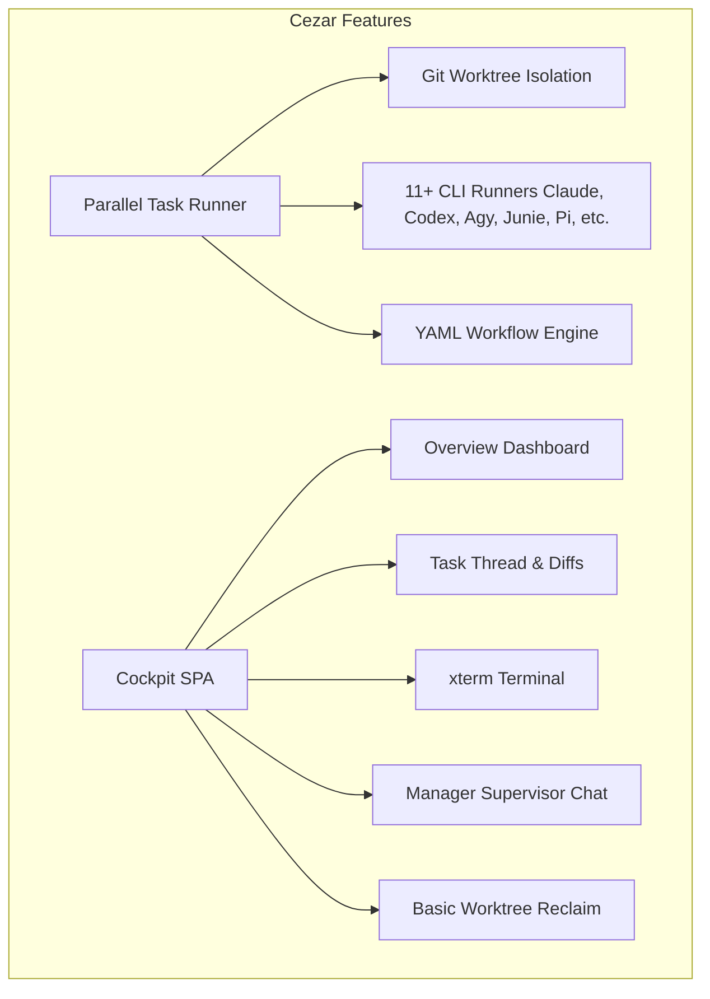
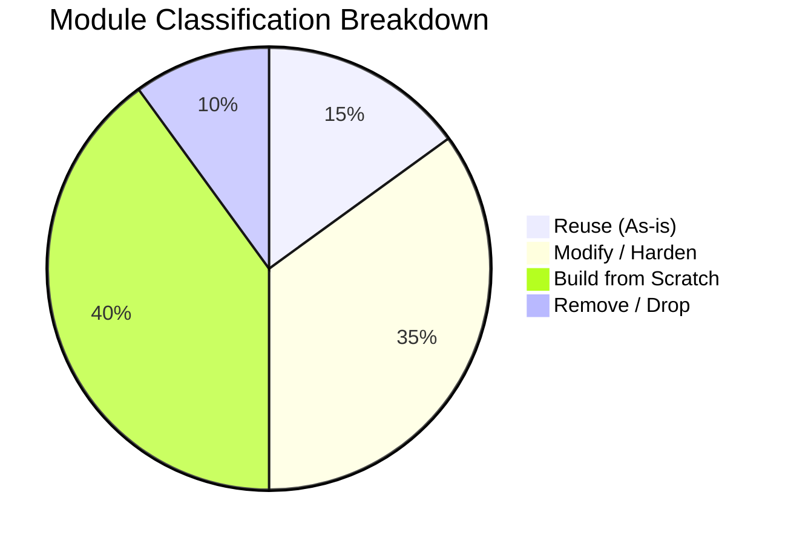
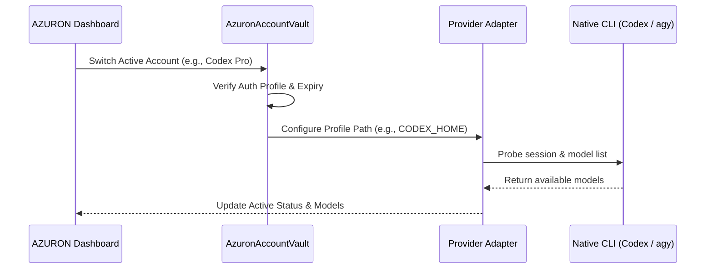
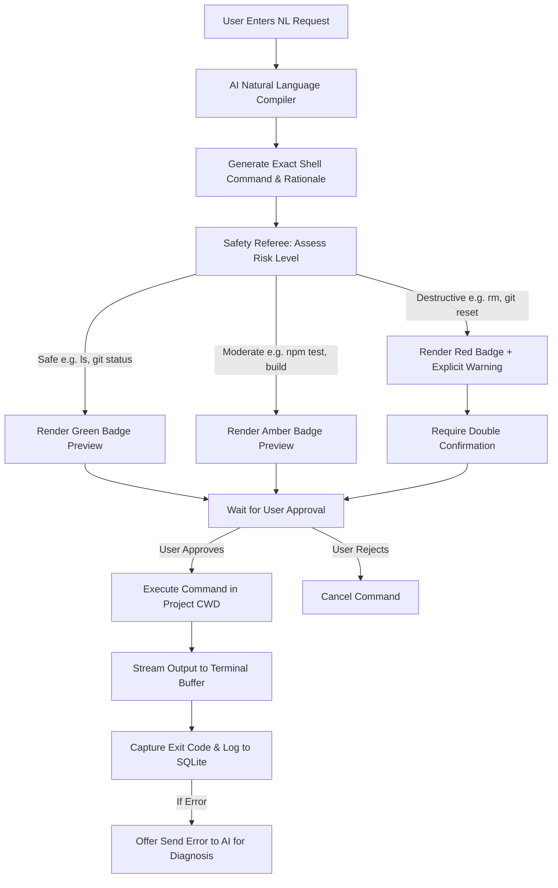
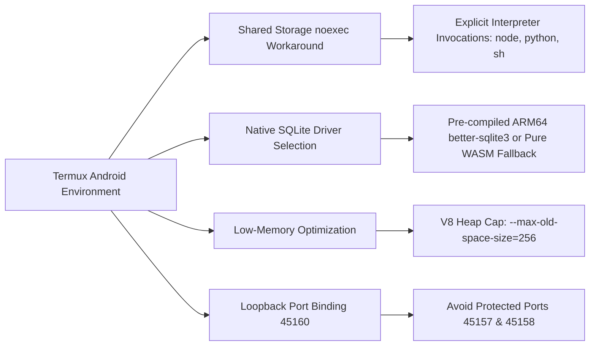
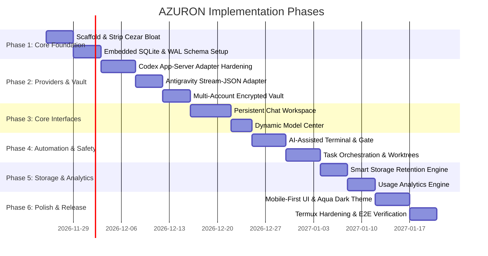

# AZURON: Master Architecture & Technical Product Plan
**The Premium, Local-First AI Coding Agent Workspace for Android & Desktop**

---

## Executive Summary

**AZURON** is a high-performance, local-first AI Coding Agent Workspace engineered for developers operating on Android (Termux) and desktop environments. Using the battle-tested orchestration concepts of **Cezar** (`open-mercato/cezar`) as an architectural baseline, AZURON strips away multi-vendor bloat, replaces fragile flat-file JSON storage with an ultra-lightweight embedded SQLite engine, and introduces five core architectural pillars missing in existing solutions:

1. **Dual Native Provider Core:** Dedicated, zero-API-key adapters for **Google Antigravity CLI** (`agy`) and **OpenAI Codex CLI** (`codex app-server`), preserving existing authenticated CLI sessions.
2. **First-Class Persistent Chat Workspace:** Independent, project-aware, searchable, pinnable, and archivable conversations with lazy loading.
3. **Multi-Account Vault & 1-Click Browser OAuth:** Seamless browser-based login flow for Google and OpenAI accounts with zero terminal copy-paste hassle.
4. **Environment Auto-Detection & Integrations Hub:** Auto-detects existing Termux tools (`git`, `gh`, Node, Python) and supports direct Web UI + AI-assisted PAT connection for **GitHub**, **Vercel**, and cloud tools.
5. **AI-Assisted Terminal with Safety Gate:** Natural language-to-shell compilation with transparent rationale previews, permission classification, and mandatory human approval for destructive operations.
6. **Smart Storage Retention Engine:** Autonomous lifecycle management (7-day task logs, 30-day inactive chats, 2-day temp files, protected "Keep Forever" flags) tailored for Android flash storage constraints.
7. **Official Brand Identity:** Complete rebranding to **AZURON** featuring the custom geometric cross-diamond emblem, deep charcoal surfaces, and electric aqua accents.

---

## 1. Cezar Architecture Audit

### 1.1 Codebase & Monorepo Breakdown
Cezar (`open-mercato/cezar`, version `0.21.0`) is organized as an npm workspace monorepo:

| Package | Role | Key Technologies | Evaluation for AZURON |
|---|---|---|---|
| `packages/contract` | Shared data contracts & type definitions | TypeScript, Zod | **Reuse & Extend:** Excellent boundary validation schema design. |
| `packages/api-client` | Typed client for the Cezar HTTP/SSE API | TypeScript, fetch/undici | **Reuse:** Provides clean typing for frontend-backend communication. |
| `packages/cezar` | Local backend daemon & agent runner | Node 20+, Hono, `@hono/node-server`, `ws`, `yaml`, `proper-lockfile` | **Heavy Modification:** High-quality Hono routing and SSE implementation, but relies on flat-file JSON and carries 11+ third-party runner dependencies. |
| `packages/web` | Cockpit Single Page Application (SPA) | React 19, Vite, Tailwind CSS v4, Radix UI, TanStack Query, `@xyflow/react`, `@xterm/xterm`, Shiki | **Modify & Redesign:** Modern React 19 stack, but desktop-biased layout and heavy initial chunks require mobile-first refactoring. |

### 1.2 Agent Runner Abstraction
Cezar uses an `AgentRunner` interface (`packages/cezar/src/core/agent-runner.ts`) which defines:
- `startSession(spec: AgentRunSpec, onEvent, opts): AgentSession`
- `run(spec: AgentRunSpec, onEvent): Promise<AgentRunResult>`
- `interrupt(): Promise<void>`

Events are normalized into standard stream types: `text`, `tool-call`, `tool-result`, `session`, `turn-end`, `error`, `cost`.
- **Codex App-Server Runner:** Connects to `codex app-server` via JSON-RPC 2.0 over standard I/O (stdio). Excellent architecture: persistent process, multi-turn support (`turn/start`, `turn/steer`, `turn/interrupt`), structured model discovery via `model/list`.
- **Antigravity Runner:** Spawns `agy` in headless mode with `--input-format stream-json --output-format stream-json --dangerously-skip-permissions -p=`. Communicates via line-delimited JSON (NDJSON) over stdin/stdout.

### 1.3 Storage & State Architecture Limitations
Cezar maintains state via flat JSON and NDJSON files:
- `~/.cezar/config.json`: Global workspace configuration and project registry.
- `.ai/cezar/runs.json`: Monolithic array of all task summaries per project.
- `.ai/cezar/events/<runId>.ndjson`: Append-only event stream per task.
- `proper-lockfile`: File-based mutual exclusion locks.

**Critical Weaknesses for Android / Termux:**
1. **Memory Spikes & GC Pressure:** As task history grows past 100 runs, reading and rewriting `runs.json` synchronously in Node.js creates severe RAM spikes on mobile devices (often triggering Android's Out-Of-Memory low-memory killer).
2. **FUSE/FAT File Locking Fragility:** Android's shared storage (`/storage/emulated/0`) and certain Termux mounts do not reliably support POSIX advisory file locks, causing sporadic lockfile crashes.
3. **Absence of Query Indexing:** Filtering tasks by date, account, model, or status requires full disk scans and in-memory parsing.

### 1.4 License & Attribution
Cezar is licensed under the permissive **MIT License** (© Patryk Lewczuk). 
- Permitted: Commercial use, modification, distribution, private use.
- Requirement: Retain the original copyright notice and MIT disclaimer in re-used files (`packages/contract`, base runner abstractions).

---

## 2. Existing Feature Inventory



- **Parallel Task Dispatch:** Runs up to `maxParallel` tasks (default 2) in isolated git worktrees.
- **Queue System:** FIFO queue with visible position numbers (`#1`, `#2`) and manual promotion ("Run First").
- **Review Gate:** Finished runs with git changes pause in a review state awaiting diff approval or draft PR push.
- **Workflow Engine:** Multi-step pipelines combining agent turns and shell verification checks (`npm test`).
- **Markdown Skills:** Extends agent instructions via `.ai/skills/<name>/SKILL.md`.
- **Host Metrics:** CPU sparkline and RAM usage sampling via WebSocket.
- **Multi-Project Cockpit:** One server instance can register multiple git folders.

---

## 3. Existing Features vs. AZURON Requirements Comparison

| Capability | Cezar Implementation | AZURON Requirement | Decision |
|---|---|---|---|
| **Primary Workflow** | Task-and-Worktree execution | Persistent Conversations + Tasks + AI Terminal | **Major Evolution** |
| **Chat System** | No standalone chat (only task-runs and experimental "Manager") | First-class persistent chat workspace (search, pin, archive, project-aware) | **Build from Scratch** |
| **Supported Providers** | 11+ runners (Claude, Junie, OpenCode, Pi, Cursor, etc.) | Strictly **Google Antigravity** & **OpenAI Codex** | **Streamline & Harden** |
| **Authentication & Accounts** | Single active host CLI login per tool | Multi-account management (switching, encrypted vault, token tracking) | **Build from Scratch** |
| **Model Center** | Ephemeral in-memory picker popup | Dedicated Models section with capabilities, reasoning effort, locked states | **Build from Scratch** |
| **Terminal / CLI** | Interactive xterm tab (raw bash) | **AI-Assisted Terminal** (NL-to-shell, preview, explanation, safety approvals) | **Build from Scratch** |
| **Storage & Retention** | Flat JSON files + simple worktree idle days | Embedded SQLite + Automated Multi-Tier Storage Retention Engine | **Rewrite Engine** |
| **Usage Analytics** | Basic token/cost list from text logs | Multi-dimensional analytics (account, model, task, custom date ranges) | **Build from Scratch** |
| **Target OS / UI** | Desktop-first (responsive web view) | Phone-first (Termux optimized) + Full Desktop compatibility | **Complete Overhaul** |
| **Aesthetic / Styling** | Purple accents, generic dark UI | Deep charcoal/black (`#0A0D12`), electric aqua (`#00F2FE`), zero AI slop | **Redesign** |

---

## 4. Module Reusability & Action Plan



### 4.1 Reusable Modules (Keep with Clean Attribution)
- `packages/contract/src/`: Core Zod validation patterns and protocol types.
- `packages/cezar/src/core/agent-runner.ts`: Base interfaces and normalized event stream definitions.
- `packages/cezar/src/core/codex-app-server-runner.ts`: JSON-RPC protocol handling for Codex CLI.
- `packages/cezar/src/core/antigravity-runner.ts`: Line-delimited stream-json I/O for `agy`.
- `packages/cezar/src/server/sse.ts`: Server-Sent Events dispatch mechanism.
- Git Worktree operations: Creation, branch naming, and diff computation utilities.

### 4.2 Modules Requiring Modification
- **Server Core (`server.ts`):** Bind strictly to local loopback (`127.0.0.1`), remove external reverse-proxy scripts (`server-install`, `server-deploy`), and optimize for low memory.
- **Runner Factory (`runner-factory.ts`):** Strip all unused runners (Claude, Junie, Pi, Kimi, Cursor, Copilot, OMP, OpenCode). Retain and specialize only Antigravity and Codex.
- **Workflow Graph (`workflow-graph/`):** Streamline node editor for mobile touch interaction.

### 4.3 Modules to Build from Scratch
- `AzuronChatManager`: Conversation persistence, message threading, virtualized lazy-loading.
- `AzuronAccountVault`: Multi-account credential manager with AES-256-GCM encryption.
- `AzuronModelCenter`: Dynamic discovery aggregator, capability inspector, reasoning effort controller.
- `AzuronAiTerminal`: Natural language command translator, safety referee, and execution loop.
- `AzuronStorageRetentionEngine`: Automated cleanup worker, activity tracking, dry-run reports, backup/restore.
- `AzuronAnalytics`: Multi-dimensional metrics engine with custom date filters.
- `AzuronMobileShell`: Bottom navigation, drawer layout, touch-optimized card interfaces.

### 4.4 Modules to Remove
- Remote VPS setup scripts (`server-install/ubuntu-vps.md`, nginx generation).
- Legacy issue tracker bridges (Jira / Linear enterprise connectors).
- Native desktop AppImage/DMG build pipelines.
- Experimental runners (`junie`, `pi`, `opencode`, `omp`, `kimi`).

---

## 5. System Architecture

```
┌────────────────────────────────────────────────────────────────────────┐
│                      AZURON DASHBOARD (SPA)                            │
│  React 19 • Tailwind v4 • Lucide • Shiki • Virtualized List (Virtua)   │
│  [Overview] [Chat] [Terminal] [Tasks] [Models] [Accounts] [Storage]    │
└───────────────────────────────────┬────────────────────────────────────┘
                                    │ HTTP / REST & Server-Sent Events (SSE)
┌───────────────────────────────────▼────────────────────────────────────┐
│                    AZURON LOCAL BACKEND (Node.js)                      │
│             Hono Framework • Port 45160 • Localhost-Only               │
├──────────────────┬──────────────────┬──────────────────┬───────────────┤
│  Chat Service    │ Task Orchestrator│ AI Terminal      │ Storage Engine│
│  • Threads       │ • Queue Engine   │ • NL Compiler    │ • Retention   │
│  • Attachments   │ • Worktrees      │ • Safety Referee │ • Log Rotator │
│  • Search        │ • Workflows      │ • Output Buffer  │ • Dry-Run     │
├──────────────────┴──────────────────┴──────────────────┴───────────────┤
│                  Account Vault & Provider Registry                     │
│  • AES-256-GCM Credentials • Profile Switcher • Health Probing         │
├─────────────────────────────────────┬──────────────────────────────────┤
│    Google Antigravity Adapter       │      OpenAI Codex Adapter        │
│    (agy CLI --stream-json)          │      (codex app-server RPC)      │
└──────────────────┬──────────────────┴──────────────────┬───────────────┘
                   │                                     │
┌──────────────────▼─────────────────────────────────────▼───────────────┐
│                     PERSISTENCE & SYSTEM LAYER                         │
│  • Embedded SQLite (WAL Mode) for indexed metadata & chats             │
│  • Local Filesystem for worktrees, patches, and logs                   │
│  • Android Kernel (Linux 6.1+ ARM64) & Termux Environment              │
└────────────────────────────────────────────────────────────────────────┘
```

### 5.1 Persistent Global Event Bus & Zero-Loss Navigation Architecture
In traditional SPAs (including Cezar), navigating between routes unmounts view components and aborts local Server-Sent Events (SSE) or WebSocket listeners. This causes live task streams to disappear, turns to freeze, and state to vanish until a task settles. 

AZURON completely eliminates this bug through an application-level **Singleton Event Hub**:

1. **Root-Level Singleton Lifecycle (`AzuronStreamHub`):**
   - The SSE and WebSocket connection lives exclusively at the top-level `<App />` provider, completely decoupled from individual page route lifecycles.
   - Navigating between `/chat`, `/tasks`, `/terminal`, or `/marketplace` **never disconnects or resets** the active data stream.
2. **Global In-Flight Mini-Runner Bar:**
   - While an agent is actively working on a task or chat, if the user switches to another page, a sleek persistent mini-runner bar docks at the bottom:
     `[ACTIVE RUN] Task: Implement Auth Hook • Step: Running Vitest • 1m 24s • [Return to Task]`
   - Users maintain live awareness of active work across all pages.
3. **Zero-Flicker View Rehydration:**
   - Returning to an active task or chat instantly binds to the persistent global in-memory buffer. Zero missing tokens, zero re-rendering glitches, and zero layout shift.
4. **Mobile Throttle Resilience (`Last-Event-ID` SQLite Replay):**
   - If Android OS throttles browser network sockets when the app is backgrounded, AZURON uses the standard `Last-Event-ID` header upon refocus to replay any missed events directly from SQLite, guaranteeing 100% data continuity.

---

## 6. Proposed Database & Local Storage Schema

Instead of unindexed flat JSON files, AZURON uses an embedded **SQLite database (`azuron.db`)** operated in **Write-Ahead Logging (WAL) mode**. This provides instant indexing, sub-millisecond queries, atomic ACID transactions, and zero RAM bloat.

### 6.1 Database Schema (DDL)

```sql
-- 1. Accounts & Credentials
CREATE TABLE IF NOT EXISTS accounts (
    id TEXT PRIMARY KEY,
    provider TEXT NOT NULL CHECK(provider IN ('antigravity', 'codex')),
    account_name TEXT NOT NULL,
    auth_profile_path TEXT,
    encrypted_credentials TEXT, -- AES-256-GCM encrypted JSON
    is_active INTEGER NOT NULL DEFAULT 0,
    status TEXT NOT NULL DEFAULT 'unverified', -- 'active', 'expired', 'error'
    token_usage_cached TEXT, -- JSON summary of usage limits if exposed
    created_at INTEGER NOT NULL,
    updated_at INTEGER NOT NULL
);

-- 2. Projects
CREATE TABLE IF NOT EXISTS projects (
    id TEXT PRIMARY KEY,
    name TEXT NOT NULL,
    filesystem_path TEXT NOT NULL UNIQUE,
    base_branch TEXT NOT NULL DEFAULT 'main',
    tags TEXT, -- Comma-separated or JSON array
    instructions TEXT, -- Project-specific prompt
    created_at INTEGER NOT NULL,
    updated_at INTEGER NOT NULL
);

-- 3. Persistent Conversations (Chat)
CREATE TABLE IF NOT EXISTS conversations (
    id TEXT PRIMARY KEY,
    project_id TEXT REFERENCES projects(id) ON DELETE CASCADE,
    account_id TEXT REFERENCES accounts(id) ON DELETE SET NULL,
    provider TEXT NOT NULL,
    model TEXT NOT NULL,
    title TEXT NOT NULL,
    is_pinned INTEGER NOT NULL DEFAULT 0,
    is_archived INTEGER NOT NULL DEFAULT 0,
    is_protected INTEGER NOT NULL DEFAULT 0, -- Keep Forever flag
    last_activity_at INTEGER NOT NULL,
    created_at INTEGER NOT NULL
);
CREATE INDEX IF NOT EXISTS idx_conversations_activity ON conversations(last_activity_at DESC);
CREATE INDEX IF NOT EXISTS idx_conversations_project ON conversations(project_id);

-- 4. Messages (Lazy-Loaded)
CREATE TABLE IF NOT EXISTS messages (
    id TEXT PRIMARY KEY,
    conversation_id TEXT NOT NULL REFERENCES conversations(id) ON DELETE CASCADE,
    role TEXT NOT NULL CHECK(role IN ('user', 'assistant', 'system', 'tool')),
    content TEXT NOT NULL,
    tool_calls_json TEXT,
    attachments_json TEXT,
    tokens_input INTEGER DEFAULT 0,
    tokens_output INTEGER DEFAULT 0,
    tokens_cached INTEGER DEFAULT 0,
    cost_reported REAL DEFAULT 0.0,
    created_at INTEGER NOT NULL
);
CREATE INDEX IF NOT EXISTS idx_messages_conversation ON messages(conversation_id, created_at ASC);

-- 5. Tasks & Orchestration
CREATE TABLE IF NOT EXISTS tasks (
    id TEXT PRIMARY KEY,
    project_id TEXT NOT NULL REFERENCES projects(id) ON DELETE CASCADE,
    conversation_id TEXT REFERENCES conversations(id) ON DELETE SET NULL,
    parent_task_id TEXT REFERENCES tasks(id) ON DELETE SET NULL,
    title TEXT NOT NULL,
    status TEXT NOT NULL CHECK(status IN ('queued', 'running', 'review', 'done', 'failed', 'cancelled')),
    provider TEXT NOT NULL,
    model TEXT NOT NULL,
    worktree_path TEXT,
    branch_name TEXT,
    diff_stat TEXT,
    peak_memory_mb REAL DEFAULT 0.0,
    is_protected INTEGER NOT NULL DEFAULT 0,
    settled_at INTEGER,
    created_at INTEGER NOT NULL,
    updated_at INTEGER NOT NULL
);
CREATE INDEX IF NOT EXISTS idx_tasks_status ON tasks(status);
CREATE INDEX IF NOT EXISTS idx_tasks_project ON tasks(project_id);

-- 6. AI Terminal Command History & Approvals
CREATE TABLE IF NOT EXISTS terminal_commands (
    id TEXT PRIMARY KEY,
    project_id TEXT NOT NULL REFERENCES projects(id) ON DELETE CASCADE,
    user_prompt TEXT NOT NULL,
    compiled_command TEXT NOT NULL,
    explanation TEXT NOT NULL,
    risk_level TEXT NOT NULL CHECK(risk_level IN ('safe', 'moderate', 'destructive')),
    approval_status TEXT NOT NULL CHECK(approval_status IN ('pending', 'approved', 'rejected')),
    exit_code INTEGER,
    output_log TEXT,
    executed_at INTEGER,
    created_at INTEGER NOT NULL
);

-- 7. Granular Usage Records
CREATE TABLE IF NOT EXISTS usage_records (
    id TEXT PRIMARY KEY,
    provider TEXT NOT NULL,
    account_id TEXT REFERENCES accounts(id) ON DELETE SET NULL,
    model TEXT NOT NULL,
    task_id TEXT REFERENCES tasks(id) ON DELETE SET NULL,
    conversation_id TEXT REFERENCES conversations(id) ON DELETE SET NULL,
    tokens_input INTEGER DEFAULT 0,
    tokens_output INTEGER DEFAULT 0,
    tokens_cached INTEGER DEFAULT 0,
    cost_reported REAL DEFAULT 0.0,
    recorded_at INTEGER NOT NULL
);
CREATE INDEX IF NOT EXISTS idx_usage_recorded_at ON usage_records(recorded_at DESC);
CREATE INDEX IF NOT EXISTS idx_usage_provider ON usage_records(provider);

-- 8. Retention Policies Configuration
CREATE TABLE IF NOT EXISTS retention_policies (
    category TEXT PRIMARY KEY, -- 'task_logs', 'inactive_chats', 'temp_files', 'usage_history'
    retention_days INTEGER NOT NULL,
    is_enabled INTEGER NOT NULL DEFAULT 1,
    last_cleaned_at INTEGER
);
```

### 6.2 Filesystem Hierarchy
```
~/.azuron/
├── azuron.db             # SQLite database (WAL mode)
├── azuron.db-wal         # Write-Ahead Log
├── secrets/
│   └── master.key        # 256-bit AES master key (0600 file permissions)
├── profiles/
│   ├── google/           # Independent Google auth session states
│   └── codex/            # Independent Codex auth configurations
└── tmp/                  # Transient scratch buffers (auto-reaped after 2 days)
```

---

## 7. Provider Integration Architecture

AZURON intentionally supports **only two first-class providers** at launch to ensure enterprise-grade stability, zero hallucinated features, and deep protocol alignment.

### 7.1 OpenAI Codex CLI Integration
- **Executable Discovery:** Checks `$PATH` for `codex`, overridden via `AZURON_CODEX_BIN`.
- **Protocol:** `codex app-server` (JSON-RPC 2.0 over bidirectional stdio).
- **Session Transport:**
  ```json
  {"jsonrpc":"2.0","id":1,"method":"thread/start","params":{"model":"o3-mini","cwd":"/path/to/worktree"}}
  {"jsonrpc":"2.0","id":2,"method":"turn/start","params":{"threadId":"thr_123","input":[{"type":"text","text":"Implement feature"}]}}
  ```
- **Real-Time Streaming:** Maps `item.delta` notifications directly to SSE streams.
- **Model Discovery:** Direct query to `model/list` RPC endpoint returning real models, displayName, description, and `supportedReasoningEfforts` (`low`, `medium`, `high`).
- **Multi-Account Strategy:** Uses isolated `$CODEX_HOME` directories (`~/.azuron/profiles/codex/<account_id>`). Switching accounts swaps the target config directory before spawning the worker thread, completely preserving each account's independent OAuth tokens.

### 7.2 Google Antigravity CLI Integration
- **Executable Discovery:** Checks `$PATH` for `agy`, overridden via `AZURON_AGY_BIN`.
- **Protocol:** Persistent subprocess with `--input-format stream-json --output-format stream-json --dangerously-skip-permissions -p=`.
- **Turn Stdin Frame:**
  ```json
  {"event":"user","message":{"content":"Task instructions..."}}
  ```
- **Real-Time Streaming:** Streams NDJSON stdout frames (`step_update`, tool calls, outputs) to the client, terminating each turn on the `result` event.
- **Distinction from Gemini CLI:** AZURON strictly distinguishes between Antigravity (`agy`) and Google Gemini CLI (`gemini`). Antigravity is an agentic coding environment utilizing internal tools, task loops, and subagents; Gemini CLI is a simple stateless prompt-response wrapper.
- **Multi-Account Strategy:** Uses distinct `GEMINI_CLI_CONFIG_DIR` or credentials profiles under `~/.azuron/profiles/google/<account_id>`, enabling clean switching across personal, work, and developer Google accounts without disturbing device-level logins.

---

## 8. Multi-Account Management & Security Vault



### 8.1 Key Vault Security Architecture
- **Encryption:** AES-256-GCM authenticated encryption for stored profile credentials and tokens.
- **Key Generation:** Master key generated using cryptographically secure random bytes (`crypto.randomBytes(32)`), saved with user-only permissions (`0600`) at `~/.azuron/secrets/master.key`.
- **No Remote Transmission:** Account credentials never leave the local device; requests are dispatched exclusively to official provider endpoints via the native CLIs.
- **Compliance Guardrail:** Account switching is designed strictly for project separation and legitimate multi-account management (e.g., personal vs. organization accounts). It does NOT circumvent provider rate limits or subscription quotas. Automatic fallback triggers only when explicit provider-level account exhaustion is reported and configured by the user.

### 8.2 Environment Auto-Detection Engine (`AzuronEnvironmentInspector`)
AZURON scans the host Termux userspace on startup to detect pre-configured tools, avoiding redundant setups:
- **Git User Identity:** Automatically inspects `~/.gitconfig` and runs `git config --get user.name` & `user.email`.
- **GitHub CLI (`gh`):** Detects existing authentication via `gh auth status`. If found, auto-activates GitHub integration without asking the user for credentials.
- **Node & Python Toolchains:** Auto-probes global runtimes (`node`, `python`, `npm`, `pnpm`, `pip`, `pkg`).

### 8.3 Integrations Hub (GitHub, Vercel & Cloud Toolchains)
When tools are not pre-configured in Termux, users can connect them seamlessly:
- **1-Click Web UI Configuration:** Dedicated "Integrations" surface where users paste Personal Access Tokens (PAT):
  - **GitHub PAT:** Fallback when `gh` CLI is absent/logged-out. Enables repository cloning, issue listing, pull request creation, and commit status checks.
  - **Vercel PAT / Token:** Connects Vercel projects, displays deployment status, inspects preview URLs, and triggers builds directly from task review gates.
- **AI-Assisted Configuration:** Users can simply type in the AI Terminal or Chat:
  > *"Mera Vercel token yeh raha: [token], ise connect karke status check karo"*
  AZURON's referee safely extracts the secret, commits it to the encrypted vault (`~/.azuron/secrets/integrations.json`), and tests the API connection without echoing the raw token back into the transcript.

### 8.4 Unified Connectors & API Keys Hub (Single Master Page)
A single, centralized dashboard surface where ALL accounts and keys are managed:
1. **Native CLI Accounts:** Google (Antigravity N-accounts) & OpenAI (Codex N-accounts) via 1-click browser OAuth.
2. **Third-Party API Keys (BYOK):** OpenRouter, Groq, Anthropic, DeepSeek, Google AI Studio, etc.
3. **Developer Integrations:** GitHub & Vercel.
- **Unified Model Ingestion:** Adding an API key (e.g., OpenRouter or Groq) dynamically fetches its available models and merges them directly into the **Model Center** and the **Chat Composer Model Selector** alongside Antigravity and Codex models.
- **Unified Health Status:** Live badges indicate `Connected (Active)`, `Invalid Token`, or `Rate Limited` across all connectors on a single screen.

---

## 9. Model Center Design

The **Models** section is a dedicated control center for discovering, filtering, and assigning models.

### 9.1 Dynamic Discovery (Zero Hardcoding)
- Discovered live from active provider CLIs (`codex app-server` and `agy`).
- Never hardcodes model names; dynamically reflects the exact entitlements of the connected accounts.
- Caches discovered lists for 1 hour with instant manual refresh.

### 9.2 Capability Matrix Display
Each model entry renders:
- **Model Identifier & Display Name:** e.g., `o3-mini`, `gpt-4o`, `gemini-2.5-pro`.
- **Provider & Active Account:** Indicates which account entitles this model.
- **Status Badges:** `Available`, `Quota Exhausted`, `Locked by Admin`.
- **Reasoning Effort Selector:** For models advertising `supportedReasoningEfforts`, exposes `low`, `medium`, and `high` controls.
- **Context & Modality Flags:** Displays tool execution support, vision support, and context window limits if exposed by the CLI.

---

## 10. Persistent Chat System

AZURON elevates conversations to a first-class citizen alongside tasks.

### 10.1 Feature Set
- **Independent Chats:** Start ad-hoc conversations independent of git tasks, or link them directly to a project.
- **Full Persistence:** All messages, tool calls, and responses are committed to SQLite in real-time.
- **Thread Organization:** Search by title or message content, pin important threads to top, archive inactive threads, and restore on demand.
- **Lazy Loading & Virtualization:** Messages render through a virtualized scroll container (`virtua`). Historical messages are fetched in chunks of 30, keeping DOM node counts low and mobile scrolling at 60 FPS.
- **Provider Switching:** Switch between Antigravity, Codex, or BYOK models mid-thread or maintain agent consistency across sessions.

### 10.2 Interactive Chat Composer & Model Card
- **Clickable Model Pill/Card:** Positioned right inside the composer toolbar. Clicking opens a curated dropdown showing:
  - Models from connected **Antigravity** accounts.
  - Models from connected **Codex** accounts.
  - Models from active **BYOK API keys** (Groq, OpenRouter).
  - **`Auto` Mode:** Automatically routes the turn to the most cost-effective or reasoning-capable model based on prompt complexity (e.g. lightweight model for file lookups, high-reasoning model for complex architecture).

### 10.3 Multi-Agent Execution Modes (`Plan`, `Code`, `Beast`, `Auto`)
Located directly in the composer mode toggle:
- **`Plan` Mode:** Strict architectural thinking and problem-solving. Outlines structure, validates assumptions, creates diagrams, and refuses premature coding until requirements are sealed.
- **`Code` Mode:** Direct implementation. Writes production code, modifies files, runs lints, and builds the codebase.
- **`Beast` Mode:** Full autonomous agent execution loop. Runs multi-step tasks, shell checks, error auto-healing, and self-testing without stopping for micro-prompts until the task is complete.
- **`Auto` Mode:** Smart contextual router. Automatically detects user intent (e.g., *"plan banao"* -> Plan Mode; *"code likh kar test run karo"* -> Code/Beast Mode).

### 10.4 Zero-Copy In-Place File & Image Attachment Architecture
To prevent mobile storage bloat on Android Termux:
- **Zero Duplicate Copies:** Files and images attached to chats or tasks are referenced directly by their original filesystem path (`/storage/emulated/0/...` or workspace paths). They are **never duplicated** into a bloated cache folder.
- **Clean UI Display:** In the chat composer and message thread, users see a clean thumbnail preview or file chip with basename and file size.
- **Agent Hand-off:** The agent runner reads the file directly from its existing path or buffers it in-memory for the model call, ensuring zero storage wastage.

### 10.5 Speech-to-Text (STT / Voice Input)
- **Native Android Microphone Integration:** Composer includes a dedicated microphone button leveraging the browser's Web Speech API (`webkitSpeechRecognition`). Provides instant, zero-latency, local speech-to-text dictation right into the input box with zero battery drain.
- **Whisper Engine Fallback:** Optional toggle to transcribe voice notes using local Whisper or external audio endpoints for complex technical terms and accents.

### 10.6 Senior Staff Engineer Persona & Self-Refining AGENTS.md / Skills
- **Senior Staff Principal Developer Persona:**
  - Speaks with concise technical depth, intellectual rigor, and zero hollow conversational filler.
  - Adheres strictly to Bottom-Line-Up-Front (BLUF): Deliverables and direct technical answers first.
  - **Mandatory Test-Driven Rigor:** Whenever writing or modifying code, the agent must write corresponding tests, run verification commands (`npm test`, syntax check), and state the exact verification outcome. Never writes code without verifying.
- **Self-Refining Instructions & Skills:**
  - The AI can inspect, edit, and refine its own `AGENTS.md` guidelines and `.azuron/skills/<name>/SKILL.md` files upon user request in chat (e.g. *"Update my AGENTS.md to always enforce TypeScript strict mode and Tailwind v4 conventions"*).
  - Web UI provides a dedicated visual Markdown editor for workspace and project-level instructions.

---

## 11. AI-Assisted Terminal & Command Safety Gate



### 11.1 Safety Classification Rules
- **Safe (Read-Only):** `ls`, `dir`, `cat`, `git status`, `git diff`, `git log`, `pwd`, `find`.
- **Moderate (Execution / Build):** `npm run build`, `npm test`, `python main.py`, `git commit`, `git checkout -b`.
- **Destructive (High Risk):** Requires explicit text confirmation or double-click modal:
  - File deletion: `rm`, `unlink`, `shred`.
  - Git rewrites: `git reset --hard`, `git clean -fd`, `git push --force`.
  - Process killers: `kill -9`, `pkill`.

---

## 12. Smart Storage Retention Engine

Mobile flash storage on Android devices is sensitive to log accumulation and fragmentation.

### 12.1 Default Retention Policies
- **Task Logs & Transcripts:** Auto-delete after **7 days** of task settlement.
- **Inactive Chats:** Auto-archive after **30 days** without activity (based on `last_activity_at`).
- **Temporary Files & Scratch Buffers:** Auto-purge after **2 days**.
- **Usage History:** Retain records for **1 year** for analytics, then compress or purge.
- **Protected Flag ("Keep Forever"):** Any chat or task flagged as protected is excluded from all automated cleanup sweeps.

### 12.2 Android Background Execution Strategy
Android strictly enforces battery optimization and background execution restrictions:
1. **Startup Sweep:** The primary retention sweep executes automatically during AZURON backend initialization (`azuron start` or dashboard boot).
2. **Foreground Service Daemon (Optional):** Integrates with `agy-daemon` on Android:
   ```bash
   agy-daemon task add --name "Azuron Storage Cleanup" --interval 24h --command "azuron storage clean --silent"
   ```
3. **Dry-Run & Inspection:**
   - Visual disk usage breakdown (Database, Task Logs, Worktrees, Temp files).
   - "Dry Run Preview" button showing exactly which files and bytes will be freed before committing deletions.

### 12.3 Cloud Storage & Remote Backup (`rclone` & Google Drive)
To safeguard project code, chat histories, and database snapshots off-device:
- **Native `rclone` Engine:** Automatically detects Termux `rclone` (or provides 1-click install command: `pkg install rclone`).
- **Supported Cloud Remotes:** Google Drive (via OAuth Gmail login), Dropbox, S3, WebDAV, or external SFTP.
- **1-Click Web UI Backup:** Dedicated "Cloud Backup" section in Storage Manager:
  - `[Backup Project Code]`: Syncs current project repository snapshot to Google Drive.
  - `[Full AZURON Backup]`: Packages SQLite database (`azuron.db`), encrypted configs, and pinned chats into a compressed timestamped archive.
- **AI-Assisted Remote Backup:** Users can prompt in chat or AI Terminal:
  > *"Backup my tulkyt project to Google Drive"*
  The agent verifies `rclone` remote connectivity, runs the sync in the background, and reports completion with the exact Google Drive destination path.

---

## 13. Usage Analytics Engine

Provides accurate, multi-dimensional consumption analytics derived from real SQLite usage entries:

- **Metrics Tracked:** Input Tokens, Output Tokens, Cached Tokens, Reported Monetary Cost.
- **Dimensions:**
  - By Provider (Antigravity vs. Codex)
  - By Account (Personal vs. Work)
  - By Model (`o3-mini`, `gemini-2.5-pro`, etc.)
  - By Context (Task Worktree vs. Chat Workspace)
- **Preset Date Filters:** Last 7 days, Last 19 days, Last 30 days, Last 3 months, Last 6 months, Last 1 year, Custom Date Range.
- **Zero-Hallucination Policy:** If a provider does not report costs or token usage (e.g. flat subscription rate), AZURON displays `Unavailable` or `Included in Plan` rather than estimating fabricated numbers.

### 13.1 GitHub-Style Token Activity Heatmap
- **Interactive Year/Month Grid:** Renders a 52-week contribution heatmap (inspired by GitHub commits) where each square represents a day's AI development activity.
- **Color Scales:** Gradient steps from deep obsidian `#0D0D0D` through vivid azure `#7DBEFF` based on total token volume and completed task counts.
- **Day Inspector Tooltip:** Tapping/hovering on any square surfaces:
  - Date & Day
  - Total Tokens (Input, Output, Cached)
  - Number of Tasks Settled & Active Work Hours
  - Primary Model Utilized
- **Timeline Selectors:** Granular dropdowns to filter by Year (e.g., 2026) and specific Month.

### 13.2 Multi-Account Usage Aggregation & Filter Matrix
- **Global Aggregated Progress Bar:** Master consumption meter displaying total tokens consumed across all providers in the active billing window.
- **Multi-Account Filter Checkboxes:** Interactive selectors to toggle account views on and off:
  - `[x] OpenAI Codex (Pro 1)`
  - `[x] Google Antigravity (Dev)`
  - `[ ] Groq Fast Inference`
- **Quota & Plan Limits:** Visual progress meters showing percentage of 5-hour limit used, requests remaining, and reset countdown timer per account.

### 13.3 Quick "See Usage & Quota" Composer Modal
- **Sticky Entry in Model Selector:** At the bottom of the scrollable model list in the chat composer, a fixed **"📊 See Usage & Quota"** row is pinned.
- **1-Click Quota Alert:** Clicking opens an instant alert card showing real-time quota status across all connected accounts without forcing the user to navigate away from the conversation.

---

## 14. Mobile-First UI/UX & Design System (Anti-AI-Slop Standard)

### 14.1 Brand Identity & Official Logo
AZURON adopts a distinct, razor-sharp architectural emblem: a geometric cross-diamond insignia representing precision orchestration and modular intelligence.

<p align="center">
  
</p>

- **Brand Name:** **AZURON** (100% replaces legacy Cezar in all UI strings, API schemas, titles, favicons, meta tags, and CLI binaries).
- **Core Theme Rule — Strict 70-20-8-2 Distribution:**

#### Dark Theme Specification (Default)
| Proportion | Color Token | Hex Code | UI Application | Contrast Guarantee |
|---|---|---|---|---|
| **70%** | Primary Background | `#0D0D0D` | Main viewports, sidebars, panels, cards, chat canvasses | Deep, clean, distraction-free obsidian black |
| **20%** | Typography & Icons | `#FFFFFF` | ALL text (headings, body, labels) and ALL UI icons | **100% Crisp White** (Zero unreadable dull-grey text or washed-out icons) |
| **8%** | Interactive & Buttons | `#7DBEFF` | Primary action buttons, active tabs, primary toggles, highlight badges | Crisp electric sky blue / azure for tactile clarity |
| **2%** | Structural Borders | `#2B2B2B` | 1px card outlines, table borders, panel separators | Subtle, crisp structural definition |

#### Light Theme Specification
| Proportion | Color Token | Hex Code | UI Application | Contrast Guarantee |
|---|---|---|---|---|
| **70%** | Primary Background | `#FFFFFF` | Main viewports, panels, cards, and canvas backgrounds | Crisp, pure clean white |
| **20%** | Typography & Icons | `#0D0D0D` | ALL text (headings, body, labels) and ALL UI icons | **100% Solid Black** (High-contrast, zero faded text) |
| **8%** | Interactive & Buttons | `#7DBEFF` | Primary action buttons, active indicators, interactive controls | Consistent azure action color across both modes |
| **2%** | Structural Borders | `#E5E7EB` / Off-White | 1px card outlines, dividers, clean subtle borders | Clean, understated division |

- **Typography:** Inter (or Geist Sans) for high-legibility UI text; JetBrains Mono for code blocks, terminal logs, and token badges.
- **Aesthetic Guardrails (Anti-AI-Slop):**
  - STRICTLY NO legacy purple gradients or muddy rainbow transitions.
  - STRICTLY NO cheesy neon glows, text-shadow blooms, or blurred floating orbs.
  - STRICTLY NO tacky cyberpunk, sci-fi gimmicks, or artificial gradient overlays. Default is strictly the precision-crafted 70-20-8-2 high-contrast engineering aesthetic.
  - Solid matte surfaces with 1px borders adhering to the 2% border rule.
  - Guaranteed absolute readability: Text and icons flip cleanly between `#FFFFFF` (Dark) and `#0D0D0D` (Light).

### 14.2 Mobile-First Responsive Layout
- **Mobile Viewport (<768px):**
  - Persistent bottom navigation bar: `[Overview] [Chat] [Terminal] [Tasks] [Menu]`.
  - Drawer menu for secondary routes (Models, Accounts, Workflows, Storage, Settings).
  - Minimum touch target: 44px x 44px for buttons and action chips.
  - Virtualized message and task lists to prevent DOM sluggishness.
- **Desktop Viewport (>=768px):**
  - Collapsible left sidebar with full navigation tree.
  - Split-pane layout for Chat / Task and Git Diff side-by-side.

### 14.3 Proposed Navigation Structure
1. **Overview:** System status, active runs, quick stats, storage overview.
2. **Chat:** Persistent conversations workspace with interactive model selector & modes.
3. **Tasks:** Multi-agent parallel task runner, worktrees, and diff review gate.
4. **Terminal:** AI-assisted natural language shell interface with safety referee.
5. **Projects:** Registered repository management, git status, instructions.
6. **Marketplace:** Live ecosystem hub for Skills, React components, Workflows & GitHub repos.
7. **Models:** Dynamic model center, reasoning effort settings, status matrix.
8. **Accounts:** Unified connectors hub (CLI accounts, Groq/OpenRouter keys, GitHub/Vercel).
9. **Workflows:** Multi-step pipeline editor and YAML templates.
10. **Automations:** Scheduled jobs and event triggers.
11. **Usage:** Granular token and cost analytics with GitHub-style contribution heatmap.
12. **Storage:** Storage manager, retention policies, dry-run cleanup, backup/restore.
13. **Settings:** General preferences, themes (70-20-8-2 rule), shortcuts, diagnostic doctor.

---

## 15. Termux & Android Platform Optimization Plan



1. **Shared Storage `noexec` Compliance:** Android shared storage (`/storage/emulated/0`) enforces `noexec`. All helper scripts and tasks must be executed via explicit interpreter calls (`node script.js`, `python task.py`, `sh run.sh`).
2. **Binary Storage Location:** AZURON daemon and SQLite databases reside strictly inside internal app storage (`$HOME/.azuron/`), ensuring standard POSIX file execution and atomic locking capabilities.
3. **Node.js Memory Capping:** AZURON CLI starts the Node server with `--max-old-space-size=256` to prevent runaway memory usage, keeping total RAM footprint below 120MB.
4. **PTY Fallback for Android:** Terminal execution avoids fragile native `node-pty` compilation by utilizing standard Node.js `child_process.spawn` with piped pseudo-TTY buffering when native PTY is unavailable.
5. **Interactive Terminal Logging & Crash Protection:**
   - When running `azuron` in Termux, output utilizes modern CLI styling (`chalk`, formatted box borders) showing live status, local URL (`http://localhost:45160`), active accounts, and real-time color-coded event feeds (`[START]` Task Start, `[CHECK]` Check/Approval, `[TURN]` Turn, `[ERROR]` Error).
   - Automated log capture writes full debug streams to `~/.azuron/logs/azuron.log`. In the event of an unhandled exception or crash, error traces are preserved and can be diagnosed instantly via `azuron doctor`.

---

## 16. AZURON Marketplace & Live Ecosystem Hub

The **Marketplace** is a dynamic, live ecosystem browser that connects AZURON to the global open-source developer ecosystem without hardcoded catalogs.

```
┌────────────────────────────────────────────────────────────────────────┐
│                        AZURON MARKETPLACE                              │
│  [Search Marketplace: "design", "tailwind", "testing"]                │
│  [All]  [Skills]  [React Components]  [Workflows]  [GitHub Repos]     │
├───────────────────┬────────────────────┬───────────────────────────────┤
│ Responsive Navbar │ Code Reviewer Pro  │ E2E Playwright Workflow       │
│ React Component   │ Agent Skill        │ Multi-Step Chain              │
│ [Inspect] [Install│ [Inspect] [Install │ [Inspect] [Install]           │
└───────────────────┴────────────────────┴───────────────────────────────┘
```

### 16.1 Live Catalog & Zero Hardcoding
- **Live Remote Discovery:** Fetches and synchronizes live catalogs directly from official community repositories (e.g. GitHub raw contents, curated component indexes, team skill repos).
- **Auto-Sync:** Newly published skills or components on GitHub appear automatically without requiring an AZURON software update.
- **Search & Dynamic Categorization:** Real-time search across categories:
  1. **Agent Skills:** Specialized agent behaviors (`SKILL.md`), playbooks, architecture guidelines.
  2. **UI & React Components:** Production-ready UI components (shadcn/ui-compatible blocks, cards, navbars, forms).
  3. **Workflow Pipelines:** Pre-baked YAML chains (e.g. Test-and-fix loops, multi-agent cross review).
  4. **GitHub Repositories:** Direct GitHub repository search with 1-click clone or URL copy.

### 16.2 VS Code-Style Inspection Drawer & Zero Storage Bloat
Clicking on any marketplace card opens a rich inspection pane:
- **Remote Markdown Rendering:** Live preview of the component/skill README, author, version, and dependencies.
- **Remote Image Streaming:** All screenshot previews and media are rendered directly from remote CDN URLs — **zero local downloads**, preventing storage accumulation on mobile flash memory.
- **1-Click Actions:** `[Install in Project]`, `[Install Globally]`, or `[Copy Source URL]`.

### 16.3 Installation Runner & Alert Modal
When the user clicks `[Install]`:
1. **Interactive Progress Card:** A clean modal opens with a live installation feed showing package download, hash verification, and placement into `.azuron/skills/` or `src/components/`.
2. **Settle Message:** Once installation succeeds, the modal displays:
   > *"Installation Complete. You can close this window now or continue working."*
3. **Safe Dismissal:** A clean `[Close]` button allows the user to dismiss the alert at their convenience.

### 16.4 AI Agent Marketplace Integration
The AI agent is equipped with native marketplace query tools (`search_marketplace`, `install_marketplace_item`):
- Users can prompt in chat:
  > *"Use the best responsive navbar design component for my website"*
- The agent autonomously searches the live marketplace, inspects the top component, and installs it directly into the project workspace with zero manual searching required.

---

## 17. Development Roadmap & Phasing




---

## 18. Potential Technical Risks & Mitigation

| # | Risk Description | Severity | Impact | Mitigation Strategy |
|---|---|---|---|---|
| 1 | **Android OOM Killer:** Android terminates Node.js background process during high memory usage. | High | Task interruptions | Enforce `--max-old-space-size=256`, virtualize message lists, stream SSE without in-memory buffering, and leverage Android Foreground WakeLock via `agy-daemon`. |
| 2 | **Git Worktree Storage Exhaustion:** Multiple parallel worktrees exhaust mobile flash memory. | High | Disk full, failed tasks | Enforce strict disk floor guard (`minFreeGb: 3`), cap parallel worktrees to 2 on Android, and trigger automated worktree reclaims on settle. |
| 3 | **Provider CLI Protocol Drift:** Updates to `agy` or `codex` alter stdin/stdout JSON formats. | Medium | Adapter parse errors | Decouple adapter parsers using strict Zod schemas with fallback error envelopes. |
| 4 | **Native Module Compilation in Termux:** Native npm modules (e.g. `node-pty`, keyrings) fail to compile on Android ARM64. | High | Installation failure | Eliminate all optional native compilation dependencies; use pure JS/WASM SQLite and piped child processes. |
| 5 | **Accidental Destructive Execution:** AI-assisted terminal generates dangerous commands (`rm -rf`). | Critical | Local data loss | Mandatory two-stage human approval with highlighted warnings and blocked execution without positive user consent. |

---

## Conclusion & Next Steps

This Master Architecture Plan establishes a concrete, rock-solid engineering path for **AZURON**. By leveraging the best architectural facets of Cezar, replacing its fragile components with an indexed SQLite engine, and introducing dedicated multi-account, persistent chat, AI terminal, and storage retention systems, AZURON will deliver a lightweight, premium development workspace tailored specifically for mobile and desktop environments.

**Awaiting user approval to proceed with Phase 1 scaffolding.**
